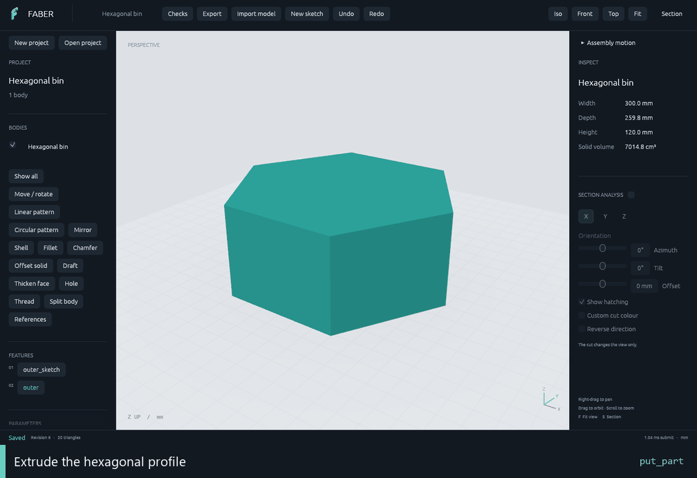
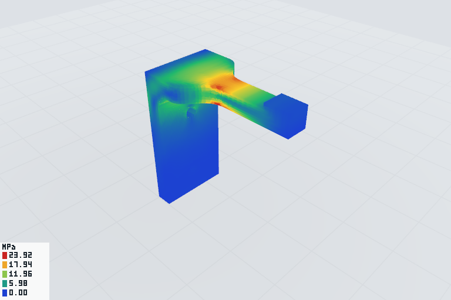
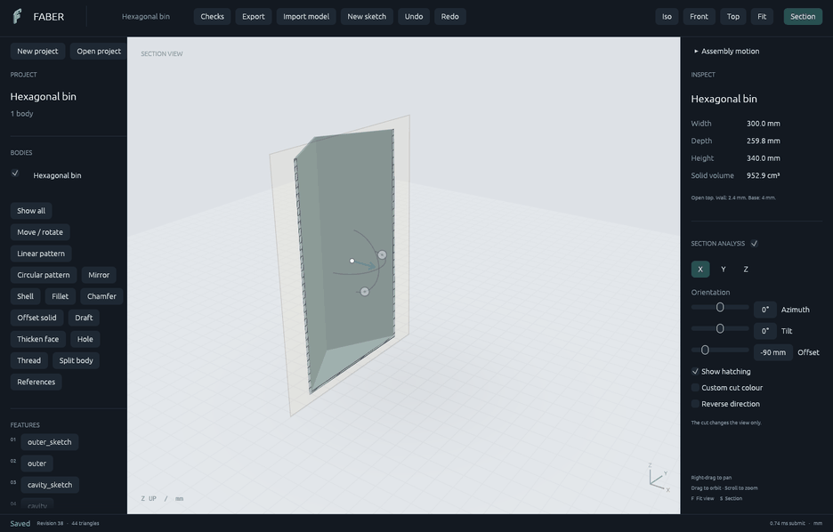
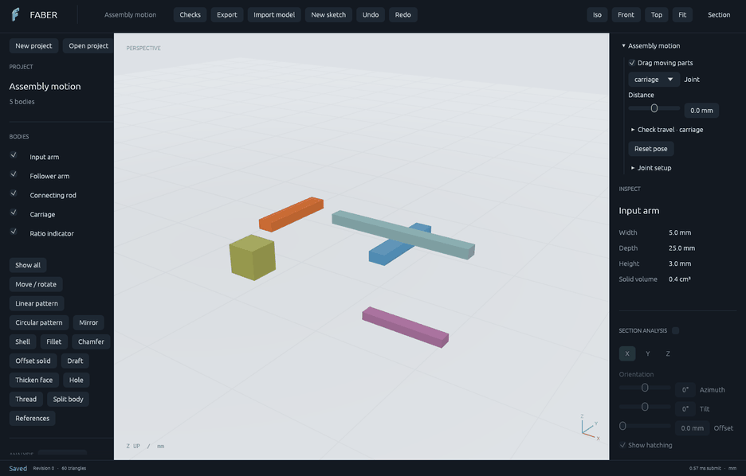
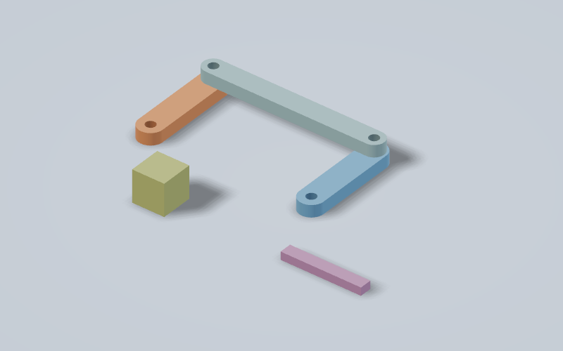

<p align="center"></p>

<h1 align="center">Faber</h1>

<p align="center">
  <b>Parametric 3D CAD for AI coding agents.</b><br>
  Build parts through MCP, inspect the solids in the viewer and edit the same project with the mouse.
</p>

<p align="center">
  <a href="#quick-start">Quick start</a> ·
  <a href="#viewer-tour">Viewer tour</a> ·
  <a href="#tools">MCP tools</a> ·
  <a href="docs/modelling-guide.md">Modelling guide</a>
</p>

<p align="center"></p>

<p align="center"><sub>From a hexagonal blank to a STEP file. The captions show the MCP calls used to build and resize the part. The cut views come from Section Analysis in the viewer. <a href="examples/hex-bin">Open the example project</a>.</sub></p>

## Quick start

Start **Faber** from the application menu after installation. Choose **New project** to create a model or **Open project** to inspect an existing one. Use **Recent projects** to reopen one of the last eight projects. For a first model, open the <a href="examples/hex-bin">hexagonal bin example</a> from this repository.

For an MCP client, use the installed `faber` executable as the command and `mcp` as its argument. The viewer reads saved changes from the same project folder. Lengths are in millimetres and Z is up.

To try a stress study, open the PLA shelf bracket and run `shelf_load`. The result shows stress, displacement and the support reaction under a 100 N load. [Shelf bracket example](examples/shelf-bracket-study) · [Stress study guide](docs/modelling-guide.md#stress-study)



Open the print check example to inspect a thin wall and an unsupported tooth.
Choose a printer and orientation, then export the assembly as a 3MF file for
your slicer. [Print check example](examples/print-check) · [Print preparation guide](docs/modelling-guide.md#print-check)

### Build from source

Windows builds need the pinned OCCT SDK. See
`docs/specs/kernel-windows-research.md` for its official download and
checksum. Extract the combined archive into `.deps/occt-sdk/`. The build
copies the runtime libraries next to the executables.

```powershell
cargo build --workspace
target/debug/faber.exe mcp
target/debug/faber-viewer.exe examples/hex-bin
```

Run `faber-viewer` without a project path to open the start screen. Choose **Open project** and select the project folder's `faber.json` file or a Fusion `.f3d` archive in the system file picker.
Choose **New project** to create a project in a folder.

Use `faber-viewer shot --out welcome.png` to capture the start screen without
opening a window.

To connect an MCP client, set its command to the full path of `faber.exe`
and its arguments to `["mcp"]`. There is no required viewer or daemon.

Run `faber migrate <dir>` to split an old one-file project into the modular layout. Run `faber build <dir>` to write the files of a `design.jsonnet` source. Run `faber schema` to print the current project JSON schema. The
[modelling guide](docs/modelling-guide.md) describes batching, preview, source
queries and units. The CLI guide and MCP guide return this same text.

## Viewer tour

- **Inspect a cut.** Enable Section Analysis, then drag the arrow to move the plane. Drag either curved line or its round handle to rotate it. Hold Shift before you start a drag for fine control.

<p align="center"></p>

<p align="center"><sub>Section analysis of the <a href="examples/hex-bin">hexagonal bin</a>. The cut changes the view and preserves the solid.</sub></p>

- **Drive an assembly.** Open Assembly motion and select a joint. In the example below, the input arm drives the output arm through a connecting rod. A gear relation turns the indicator in the opposite direction.

<p align="center"></p>

Open the [assembly motion example](examples/assembly-motion) to try the same movement. Both animations use frames from the Faber viewer.

### Studio pictures and exploded assemblies

The studio view shows material reflections and a ground shadow. The explosion
separates each part for inspection. The joint axes guide the moving parts.
[Open the assembly](examples/assembly-motion) · [Pictures and animations](docs/modelling-guide.md#pictures-and-animations)

<p align="center"></p>

## Tools

- `open`: open a project, or create it with `create: true`.
- `undo`, `redo`: move through saved changes, including after reopening.
- `put_part`: add or replace a part after a successful build.
- `put_parts`: apply several part recipes as one change.
- `set_part_info`: change the name, colour, group or note of a part. The solid does not rebuild.
- `part_info`: read the complete recipe and measured result of a part.
- `topology`: read exact edge and face measurements for the current revision.
  Set `feature` to query a history feature before part placement. The response
  states whether measurements use part or world coordinates. Use the source
  feature query when you set selectors for fillet, chamfer or shell operations.
- `add_feature`: insert or append an operation to a history.
- `edit_feature`: replace an operation and rebuild its dependent results.
- `delete_feature`: delete an operation if its result is not required.
- `move_feature`: change the operation order if dependencies remain valid.
- `remove_part`: remove a part by id.
- `status`: read bounds, volume and triangle counts.
- `measure`: read the minimum distance between parts `a` and `b`, with closest
  points in world coordinates. Uses exact shapes. Zero is not penetration depth.
- `mass_properties`: read volume, surface area and centre of mass of part `id` in world coordinates. Set `density_g_cm3` to also read mass and the inertia tensor about the centre of mass. The project stays unchanged.
- `params`: read shared parameter expressions and values.
- `set_param`: change a shared parameter and rebuild affected parts.
- `render`: save a PNG image and return it through MCP. A section is optional.
- `export`: write one STL or STEP file per part.
- `preview_batch`: build proposed edits without saving. Return candidate bounds,
  volumes and the base revision. Send the same operations to `batch` with
  `expected_revision` set to that base revision to save against the same state.
  Optional `render` accepts `path`, `width`, `height` and `section`, as in the
  render tool. It returns a PNG of the candidate. It does not save the design.
- `import_part`: copy a STEP, STL, 3MF, OBJ, PLY or OFF model into the project as a new part. Supply
  `id`, `name`, an absolute `path` and optional `strict`. The source file can then
  be removed. The project checks its stored copy by content hash on rebuild.
  The viewer provides the same operation through Import model. Relative source
  paths in that form are relative to the project folder.
  STL and PLY support text and binary input. OBJ and OFF polygon faces are
  triangulated. 3MF uses build items, units and component transforms, including
  production references within the package. Mesh input stays a mesh; exact face
  queries and solid operations need STEP or a model built in Faber. Files without
  units use millimetres. Materials, textures and slicer settings are not imported.
  Mesh volume is a signed-volume estimate reported as a positive value. It is not
  a solid-validity check for an open mesh. Input is limited to 512 MiB; expanded
  3MF geometry is limited to 10 million vertices and 20 million triangles.
- `guide`: read input conventions.
- `metric_fastener`: read metric pitch, clearance, tap-drill and head dimensions.
  This query does not create geometry. The viewer Hole form also has metric
  clearance and tap-drill presets.
- `viewer`: change or read the display of a running viewer of the same project.
  Actions are `hide`, `show`, `isolate`, `show_all`, `select`, `camera`,
  `section` and `apply_view`. `camera` takes a `view` direction and frames the
  listed `parts`. Call it with no action to read the hidden parts, the
  selection and the faces or edges that the person picked. The tool never
  changes the project. If no viewer shows the project, the reply says so.

The project uses exact solids behind a geometry port. The current recipe
tools support polygon extrusion with holes and pockets with a closed floor.
Recipes store profiles, heights, placements and colours. The kernel also
has tested primitive and boolean operations. Number fields accept numbers
or expression strings. Shared parameters can refer to other parameters.
Ordered histories refer to earlier features by id and select an output.
Use `op: history`, `features: [{id, geometry}, ...]` and `output: id`.
Features support box, cylinder, sphere, cone, torus, revolve, loft, sweep, extrude,
pocket, transform, union, difference and intersection. Transform uses
`source` and `placement`; boolean operations
use `left` and `right`. Changed features rebuild their dependent results.
The remaining CAD tools are in `docs/specs/faber-plan.md`.

A sphere uses `radius`. A cone uses `base_radius`, `top_radius` and `height`;
one radius can be zero. A torus uses `major_radius` and `minor_radius`.
These primitives use the Z axis. A revolve uses a profile in the XY plane,
an axis `origin`, an `axis` direction and an `angle` in degrees, up to 360.
Use part placement or a transform feature to place the result.

A loft uses `sections: [{profile, placement}, ...]` and optional `ruled`.
Each section has a closed profile in its local XY plane. Section placements
set the position and rotation. There must be at least two sections, with
the same number of holes in each. Hole order identifies matching holes.

A sweep uses `profile`, optional `placement` and `path: [[x,y,z], ...]`.
The path contains straight segments. The placed profile must be at the
first path point and normal to its first segment. Corners use mitred joins.
Profile holes remain open along the path. Profile and path coordinates
accept parameter expressions.

A fillet uses `source`, `edges` and `radius`. A chamfer uses `source`,
`edges` and `distance`. The edge selector requires `expect` and `tolerance`.
Optional filters are `parallel`, `near_centre`, `length` and circular
`radius`. They use the source feature coordinates. The selector runs again
after a change; a wrong result count refuses the change. A failed operation
can report a smaller tested value without saving a different model.

A shell uses `source`, `faces` and a positive inward `thickness`. Selected
faces are removed. The face selector requires `expect` and `tolerance`;
optional filters are planar `normal`, `near_centre` and `area`. Normal
selection is directional, so `[0,0,1]` selects an upward planar face.

A sketch feature uses `profile` and optional `placement`. Its profile has
an `outer` loop and optional `holes`. Loop kinds are `circle` (centre and
radius), `rectangle` (origin and size), and `polygon` (points). Circles are
exact curves. Use `extrude_sketch` with `source` and a world-space `vector`
to make a solid from a sketch. A sketch alone cannot be a part output.

A `path` loop has `start` and ordered `segments`. Segment kinds are `line`
with `end`, `arc` with `via` and `end`, and cubic `bezier` with `control1`,
`control2` and `end`. The final endpoint must equal the start point. Arc
and Bezier segments remain exact curves. Either boundary direction is valid.

An `ellipse` loop uses `centre`, `major_radius`, `minor_radius` and `rotation`.
A `regular_polygon` uses `centre`, `radius`, `sides` and `rotation`. Radius
is measured to a corner; rotation is in degrees. A polygon needs at least
three sides. An ellipse requires its major radius to be at least its minor
radius.

Use `revolve_sketch` with `source`, `origin`, `axis` and `angle` to revolve
an earlier sketch. Use `loft_sketches` with ordered `sources` and optional
`ruled` to loft earlier sketches, including curved profiles and matching
holes. Sketch placement sets each loft section plane.

A `curve` feature has `path: {start, segments}` with 3D coordinates. Segment
kinds are `line`, `arc` and cubic `bezier`, with the same fields as sketch
segments. A `sweep_sketch` uses `source` for a sketch and `path` for a curve
feature. The sketch must be normal to the path at its start. Holes remain
open through the sweep.

## Example

The Rust example is an MCP client. It starts `faber mcp`, sends tool calls
and records the replies. It does not write the model file itself.

```powershell
cargo run --example build_bin -- examples/hex-bin
target/debug/faber-viewer.exe shot examples/hex-bin --out examples/hex-bin/out/viewer.png
target/debug/faber-viewer.exe shot examples/hex-bin --section Y 0 --reverse --out examples/hex-bin/out/viewer-section.png
```

The plain hexagonal bin is 300 mm across opposite corners and 340 mm high.
The wall is 2.4 mm thick and the floor is 4 mm thick. It has one solid and
an open top. There are no robot parts or other mechanisms.

## Viewer controls

- Left-drag: orbit. Right-drag or middle-drag: pan. Scroll: zoom.
- Click a face or a tree row: select a body.
- Tree checkbox: show or hide a body.
- `F`: fit the model. `S`: search for a command. `Shift+S`: enable or disable section analysis.
- Section controls: choose a plane, move it and reverse its direction.
- Azimuth and Tilt rotate the section plane for oblique cuts.
- Edit parameters: change expressions, then apply or cancel. The model builds
  in a worker. Errors keep the previous model and the input fields. Close an
  active MCP writer before saving from the GUI.
- Undo and Redo: restore a saved design state in a worker.
- Export: choose a directory and STEP or STL. Checks and output run in a worker.
  The output includes all complete bodies, including hidden bodies.
- Checks: run a background interference scan and select parts from its findings.
  Changed designs require a new scan. The clearance threshold is currently 0.1 mm.
- New sketch: choose XY, XZ or YZ, draw a rectangle, circle or polygon, then
  enter an extrusion distance and select Create solid. The saved history keeps
  separate sketch and extrusion features. Sketches currently save with a solid.
- Rectangle dimensions and circle radius accept parameter expressions. Leave
  those fields empty to keep the drawn size. The preview follows the dimensions.
- Click a feature row to edit its existing dimensions, expressions and references.
  Apply rebuilds the model; cancel discards the input. Invalid changes keep the
  last valid model. Adding sketch segments and changing operation types are not
  yet available in this editor.

Sections change the view only. Exports keep the full solid. The viewer
loads file changes in a worker and keeps the current view if a load fails.

The viewer shows each change that an MCP client saves, usually within half a
second. The `viewer` tool also lets the client hide, isolate and select parts,
turn the camera and show a section in the open viewer. The viewer and the
server use two files in the `.faber` folder of the project for this link.
These files are not project data and do not change the revision.

## Checks

Use `faber export PROJECT DIRECTORY --format step` for exact solid output.
Within a history, `linear_pattern` takes an earlier solid `source`, a `count`
including the source, and a `step` vector in millimetres. Count and step accept
expressions. Counts must be integers from 1 to 1000. Overlapping copies unite;
separate copies remain separate solids in the same part.

`circular_pattern` takes `source`, `count`, `origin`, `axis` and `angle`.
The origin is a point on the axis in part coordinates. Angle is the gap between
copies in degrees, with its sign set by the right-hand rule. For six copies
around a complete circle, use count 6 and angle 60. Both pattern types are
available in the viewer part panel.

`mirror` takes a solid `source`, a plane `origin` and `normal` in part coordinates,
and `keep_source`. When true, the result unites the source and its mirror.
The default is false. The viewer Mirror action starts with this option enabled.

The CLI defaults to STL. It accepts `--format stl` and `--force` in either order.

MCP and CLI exports refuse interference or clearance findings before writing
files. Inspect the report first. To override this check, pass `force: true` to
MCP export or `--force` to the CLI export command. Geometry must still be valid.

MCP `interference` with `{ "proximity_mm": 0.1 }` checks the current placed
bodies without changing the design. Findings use part ids. Penetration depth
is an approximate mesh measurement. This check does not yet block model saves.

Set `strict: true` on MCP `batch` to refuse a change that adds an interference
or clearance finding. The check runs before save. The same optional flag is
available on parameter, part and feature edit tools. Without it, saves require
a successful build. Persisted contact rules are not yet available.

Dimensions can use comparisons, for example `if(width >= 30, 4, 2)`.
Comparisons return 1 or 0 and run after arithmetic. `if` calculates only the
selected branch, so `if(divisor == 0, 10, 60 / divisor)` can guard division.
Both branches must have valid syntax and function argument counts.

Saved changes keep a journal and immutable snapshots in `.faber/history`.
The project file is replaced only after its journal record is saved. Undo
and redo rebuild their target before save and keep revision numbers increasing.
An external model change makes the old history unavailable. A new successful
edit starts a new history branch from that state.

Use `checkpoint` with `{ "name": "baseline" }` to save a named design state.
Use `restore` with the same name to rebuild and restore it. Restore creates
a new revision and can be undone. Names are case insensitive and cannot
be reused. Checkpoints remain in `.faber/checkpoints` after the project closes.

Use `batch` to apply related edits in one transaction:

```json
{"operations":[{"tool":"set_param","name":"height","expression":"40"},{"tool":"edit_feature","part":"body","id":"base","geometry":{"op":"box","size":[20,30,"height"]}}]}
```

The final design builds once and saves as one undo step. Any failure refuses
the whole batch. Supported edits are `set_param`, `put_part`, `remove_part`,
`add_feature`, `edit_feature`, `delete_feature`, `move_feature` and `set_part_info`.
Each batch accepts 1 to 2000 edits. File output and history moves are separate calls.

```powershell
cargo fmt --all --check
cargo clippy --offline --workspace --all-targets -- -D warnings
cargo test --offline --workspace
```

Builds use at most six jobs. Run builds in sequence. Tests use no network
and open no windows. `faber-viewer shot` runs the actual interface without
a window.
